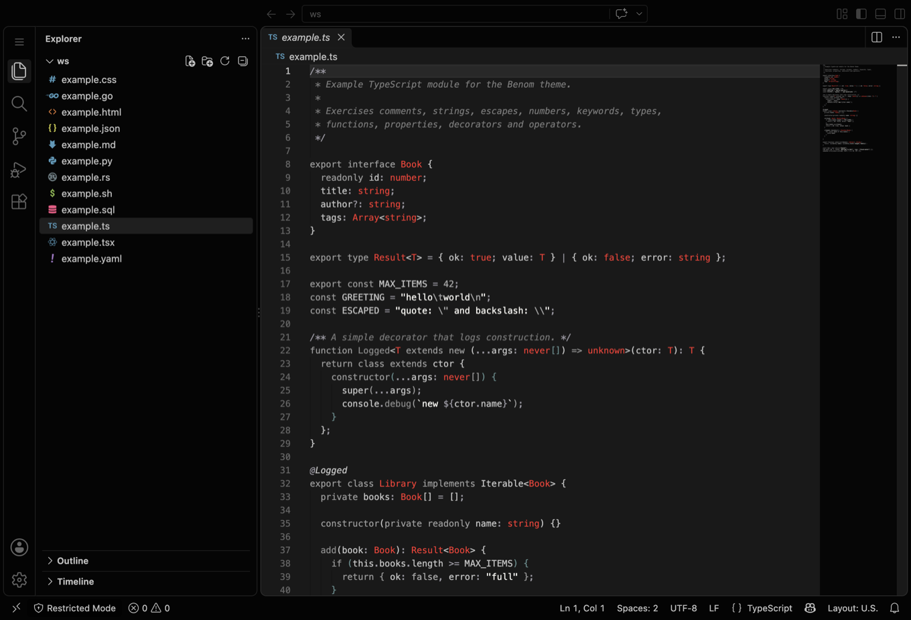
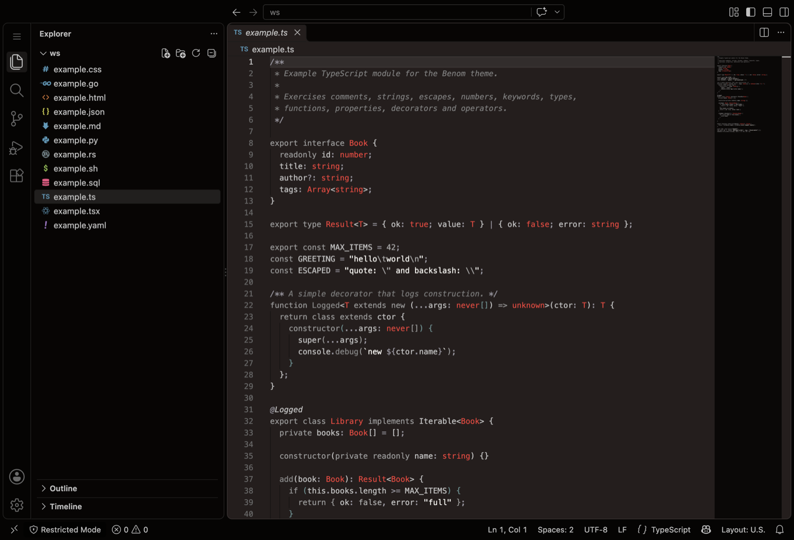

# Benom

A dark VS Code theme in two variants, built from the **Venom** palette of
[black-metal-theme-neovim](https://github.com/metalelf0/black-metal-theme-neovim)
(Apache-2.0).

Benom is almost monochrome: greys plus one red (`#fc302e`) and one teal
(`#5f8787`). Token kinds are told apart with the greys, those two accents, and
**font style** (italic, bold), not with new hues. Colors below their contrast
target are lifted to the nearest lighter shade of the same hue, so every role
stays readable through long sessions.

## Variants

| Variant | Editor background | Notes |
| --- | --- | --- |
| **Benom** | `#191919` (neutral charcoal) | The default; sidebar and chrome are near-black, the editor a step lighter. |
| **Benom Alt** | `#251e1d` (warm dark brown) | Derived from the source's `alt_bg` (`#211816`); chrome is a step darker than the editor. |

Both variants enable semantic highlighting (`editor.semanticHighlighting.enabled`)
so functions, types, properties and decorators are colored by the language
server as well as by TextMate scopes.

## Install

**From the Marketplace**

1. Open the Extensions view (`Ctrl+Shift+X` / `Cmd+Shift+X`).
2. Search for `Benom`.
3. Click **Install**, then pick **Benom** or **Benom Alt** in
   `Preferences: Color Theme` (`Ctrl+K Ctrl+T`).

**From a `.vsix` file**

1. Download `benom-<version>.vsix` from the [releases](../../releases) page.
2. Run `code --install-extension benom-<version>.vsix`, or use the
   `Extensions: Install from VSIX...` command.

**Tip:** semantic highlighting is on by default in recent VS Code versions; if
your theme looks plain, set `editor.semanticHighlighting.enabled` to `true`.

## Screenshots

**Benom** (neutral charcoal):

**Benom Alt** (warm dark brown):

## Credit

Benom is derived from the **Venom** palette of
[black-metal-theme-neovim](https://github.com/metalelf0/black-metal-theme-neovim),
Copyright metalelf0 and contributors, licensed under the
[Apache License 2.0](LICENSE). The Venom colors are taken from the album
*Welcome to Hell* (1981). See [NOTICE](NOTICE) for the full attribution.

## License

Apache-2.0 — see [LICENSE](LICENSE).
